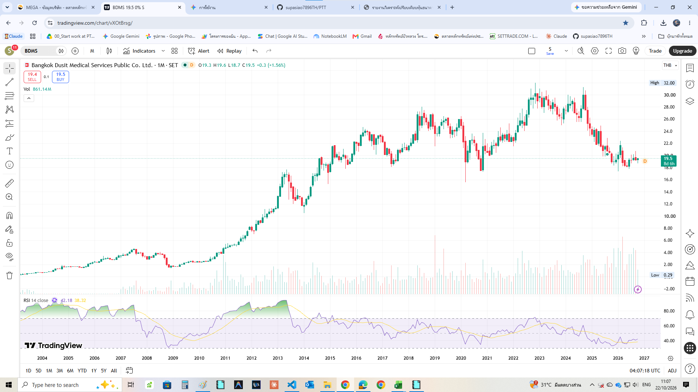
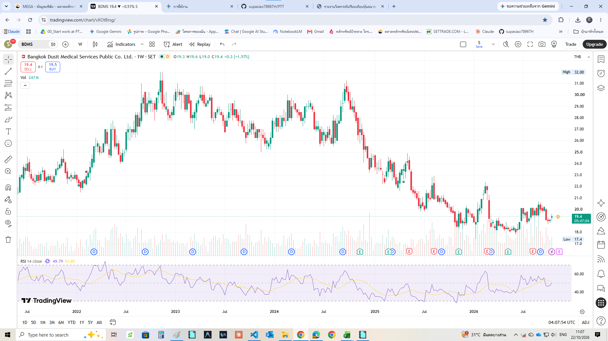
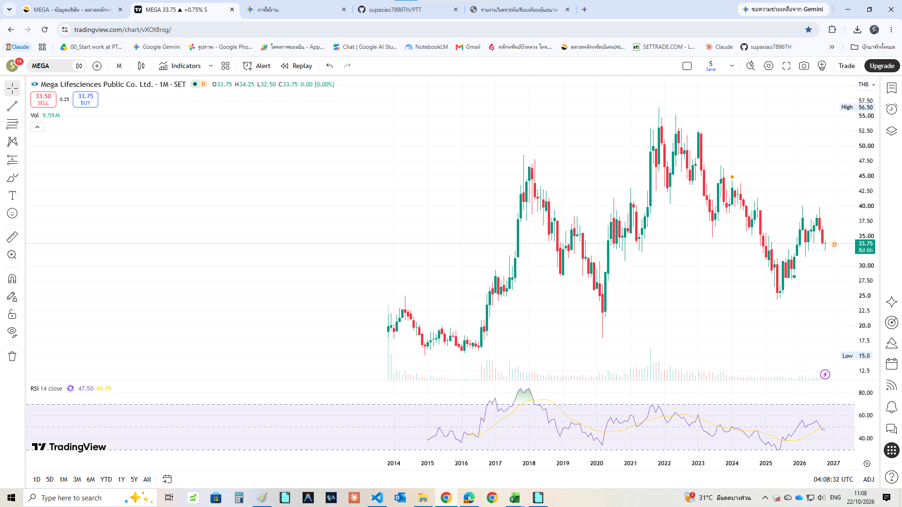
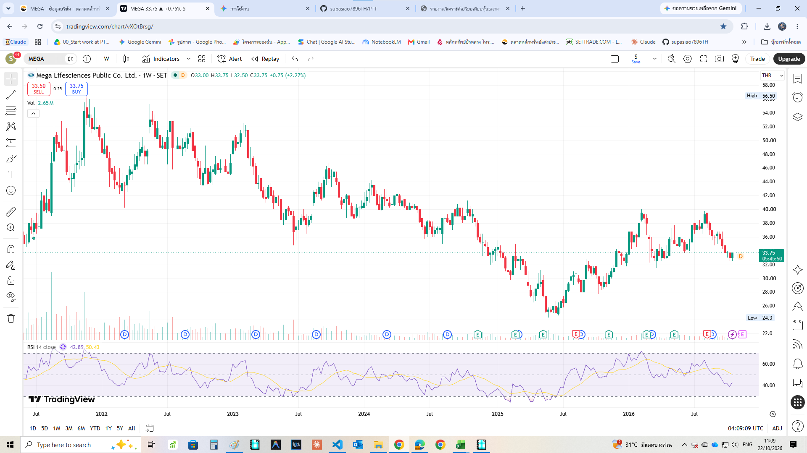

# 🏥 รายงานวิเคราะห์หุ้นสายสุขภาพรับสังคมสูงวัย (VI Analysis & Entry Timing): BDMS vs MEGA
**จัดทำสำหรับ:** พี่ A (A-Class WebCraft | Code • Share • Inspire | by Supasit.A)  
**วันที่วิเคราะห์:** 22 ตุลาคม 2569 (2026-10-22)  
**แหล่งข้อมูลอ้างอิง:**
1. แบบ 56-1 One Report ประจำปี 2568 — **บริษัท กรุงเทพดุสิตเวชการ จำกัด (มหาชน) (`BDMS`)** (`56-1_OneReport/2568/56-1_2568_BDMS.zip`)
2. แบบ 56-1 One Report ประจำปี 2568 — **บริษัท เมก้า ไลฟ์ไซแอ็นซ์ จำกัด (มหาชน) (`MEGA`)** (`56-1_OneReport/2568/56-1_2568_MEGA.zip`)
3. กราฟเทคนิคจริง `TF 1M` และ `TF 1W` ณ วันที่ 22 ตุลาคม 2569 (`BDMS_TF1M.png`, `BDMS_TF1W.png`, `MEGA_TF1M.png`, `MEGA_TF1W.png`)

---

## 🧭 บทสรุปผู้บริหาร (Executive Summary)

ประเทศไทยได้ก้าวเข้าสู่ **สังคมผู้สูงอายุอย่างสมบูรณ์ (Complete Aged Society)** และกำลังมุ่งสู่ **Super-Aged Society** (ประชากรอายุ ≥ 60 ปี เกิน 28% ของประเทศ) ควบคู่กับเทรนด์การดูแลสุขภาพเชิงป้องกัน (Preventive Wellness) และการท่องเที่ยวเชิงการแพทย์ (Medical Tourism) โดยการเปรียบเทียบ 2 หุ้นแกนหลักของกลุ่มสุขภาพและเวชภัณฑ์ไทย ณ ราคาล่าสุดวันที่ 22 ต.ค. 2569 ได้ข้อสรุปดังนี้:

| หัวข้อเปรียบเทียบสรุป | 🏥 BDMS (`19.50 บาท`) | 💊 MEGA (`33.75 บาท`) | 🏆 ผู้ชนะ / คำแนะนำจัดพอร์ต |
|---|---|---|---|
| **บทบาทในห่วงโซ่สุขภาพ** | **ปลายน้ำ (Curative & Tertiary Care):** เครือ รพ. เอกชนอันดับ 1 ของไทย (59 แห่ง, ~9,000 เตียง) | **ต้นน้ำ-กลางน้ำ (Preventive & Consumer Health):** เจ้าของแบรนด์วิตามิน/ยา `Mega We Care` (39 ประเทศ) | เสริมกันคนละด้าน (ไม่ทับซ้อนกัน) |
| **กำไรสุทธิปี 2568 (`Net Profit`)** | `15,848 ล้านบาท` (กำไรปกติ `16,187 ล้านบาท` `+2.0% YoY`) | `1,912 ล้านบาท` (กำไรปรับปรุง `2,037 ล้านบาท`) | **🏥 BDMS** (ฐานกำไรและกระแสเงินสดใหญ่กว่า ~8 เท่า) |
| **`EPS` / `BVPS` ปี 2568** | `EPS = 1.00 บาท` (`Norm. 1.02`) / `BVPS = 6.66 บาท` | `EPS = 2.19 บาท` (`Adj. 2.34`) / `BVPS = 11.72 บาท` | — |
| **`ROE` / ฐานะการเงิน (`Net IBD/E`)** | `ROE = 15.4%` / `IBD/E = 0.2x` (`Net IBD/E = 0.1x`) | **`ROE = 19.0%`** / **`Net Cash = +4,156 ล้านบาท` (`Net D/E = -0.41x`)** | **💊 MEGA** (งบดุลไร้หนี้ เงินสดท่วม 29.4% ของสินทรัพย์) |
| **`P/E Ratio` / `P/BV Ratio` ณ ปัจจุบัน** | **`P/E = 19.50x`** (ต่ำสุดในรอบ 10+ ปี!) / `P/BV = 2.93x` | **`P/E = 15.41x`** (`Adj. P/E 14.42x`) / `P/BV = 2.88x` | **🏥 BDMS** (ถูกกว่าค่าเฉลี่ยในอดีตของตัวเองที่ 28–35x มากที่สุดในรอบทศวรรษ) |
| **เงินปันผลต่อหุ้นปี 2568 (`DPS`)** | **ปกติ `0.75 บาท`** (**รวมปันผลพิเศษ = `1.00 บาท`**) | **`1.60 บาท`** (`Payout Ratio = 73.0%`) | — |
| **Gross Dividend Yield (ก่อนหักภาษี)** | **ปกติ `3.85%`** (**รวมปันผลพิเศษ = `5.13%`**) | **`4.74%`** (`Net Yield = 4.27%`) | **💊 MEGA** (สำหรับปันผลปกติ) / **🏥 BDMS** (จ่ายจริงปีล่าสุด `5.13%`) |
| **Operating Fair Value (DCF+PE+DDM)** | **`24.13 บาท`** (`Base Case 4 วิธี = 21.16 บาท`) | **`34.20 บาท`** (`Base Case 4 วิธี = 31.66 บาท`) | — |
| **Margin of Safety (เทียบ Operating FV)** | **`+19.19%` (Upside `+23.7%`)** ✅ | **`+1.32%` (Upside `+1.3%`)** ⚠️ | **🏆 🏥 BDMS (อยู่ใน Target Buy Zone ทันที!)** |
| **คะแนน Final VI Scorecard** | **🏆 `28 / 30` (Strong Buy at 10-Year Support)** | **🥈 `26 / 30` (High Quality — Wait for Pullback)** | **สะสม `BDMS` ทันที (`17.50–19.50`) + รอรับ `MEGA` เมื่อย่อ (`26.50–31.50`)** |

---

## 🏛️ ส่วนที่ 1: วิเคราะห์โครงสร้างธุรกิจและคูเมือง (Business Model & Economic Moat)

### 1.1 🏥 BDMS — บริษัท กรุงเทพดุสิตเวชการ จำกัด (มหาชน)
- **โครงสร้างรายได้ปี 2568 (`113,206 ล้านบาท`, `+3.5% YoY`):**
  1. **รายได้จากกิจการโรงพยาบาล (`95.1%` / `108,828 ล้านบาท`):** เครือข่ายโรงพยาบาลเอกชน 6 กลุ่มแบรนด์หลัก รวม **59 แห่ง** (เตียงจดทะเบียน ~9,000 เตียง):
     - *กลุ่มโรงพยาบาลกรุงเทพ (Bangkok Hospital Group):* 29 แห่ง
     - *กลุ่มโรงพยาบาลสมิติเวช (Samitivej Group):* 7 แห่ง
     - *โรงพยาบาลบีเอ็นเอช (BNH):* 1 แห่ง
     - *กลุ่มโรงพยาบาลพญาไท (Phyathai Group):* 6 แห่ง + *กลุ่มโรงพยาบาลเปาโล (Paolo Group):* 6 แห่ง
     - *กลุ่มโรงพยาบาลรอยัล (Royal Hospital Group - กัมพูชา):* 2 แห่ง + อื่นๆ และ **BDMS Wellness Clinic**
  2. **สัดส่วนโครงสร้างผู้ป่วย (Diversified Patient Mix):**
     - **ชาวไทย `72%` (`+3% YoY`) : ชาวต่างชาติ `28%` (`+4% YoY`)** (ชาติที่เติบโตโดดเด่นในปี 2568: เมียนมา `+14%`, กาตาร์ `+12%`, สหราชอาณาจักร `+9%`, สหรัฐฯ `+8%`)
     - **ผู้ป่วยใน (`IPD`) `51%` : ผู้ป่วยนอก (`OPD`) `49%`** (จำนวนผู้ป่วยนอกเฉลี่ยสูงถึง **36,120 คน/วัน** และครองเตียงเฉลี่ย 5,180 เตียง/วัน)
     - **โรงพยาบาลใน กทม.และปริมณฑล `54%` : ต่างจังหวัดหัวเมืองใหญ่ `46%`** (เชียงใหม่, ภูเก็ต, พัทยา, ขอนแก่น, หาดใหญ่, อุดรธานี, สุราษฎร์ธานี, เกาะสมุย ฯลฯ)
     - **สัดส่วนผู้ป่วยประกันสุขภาพ (Health Insurance Payors) พุ่งขึ้นเป็น `38%`** ของรายได้ทั้งหมด!
  3. **ธุรกิจ Non-Hospital (`3.8%` / `4,378 ล้านบาท`):** บมจ.สหแพทย์เภสัช (`Medicpharma` ผลิตยา), บจก.เอ.เอ็น.บี. ลาบอราตอรี่ (ผลิตน้ำเกลือ/เวชภัณฑ์), ร้านขายยา `Save Drug`, และศูนย์แล็บ `N Health`
- **คูเมืองทางเศรษฐกิจ (Economic Moat — `Wide Moat`):**
  - **Irreplaceable Physical Network & Prime Land:** ที่ดินและใบอนุญาตโรงพยาบาลในทำเลใจกลางเมืองและหัวเมืองท่องเที่ยว 59 แห่ง เป็นทรัพย์สินที่คู่แข่งรายใหม่ไม่สามารถสร้างเลียนแบบได้ด้วยเงินทุนปกติ
  - **Centers of Excellence (CoE):** ความเชี่ยวชาญโรคซับซ้อน (หัวใจ, มะเร็ง, สมอง, กระดูก) ของผู้สูงอายุมี Switching Cost และความเชื่อมั่นในทีมแพทย์สูงมาก
  - **Economy of Scale:** อำนาจต่อรองราคายาและเครื่องมือแพทย์สูงสุดในภูมิภาค พร้อมเครือข่ายรับส่งต่อผู้ป่วย (Referral Network) ทั่วประเทศ

### 1.2 💊 MEGA — บริษัท เมก้า ไลฟ์ไซแอ็นซ์ จำกัด (มหาชน)
- **โครงสร้างรายได้จากการดำเนินงานปี 2568 (`14,147 ล้านบาท`, `-7.8% YoY`):**
  1. **ธุรกิจผลิตภัณฑ์ภายใต้เครื่องหมายการค้า `Mega We Care™` (Branded Products — `61.7%` ของรายได้ หรือ `8,728 ล้านบาท`, เติบโต `+4.3% YoY`):**
     - วิจัย พัฒนา ผลิต และทำการตลาดวิตามิน อาหารเสริม (Nutraceuticals เช่น *Nat C, Nat B, Fish Oil, Ginkgo, Calcium-D*) และยาสั่งจ่ายโดยแพทย์ (Prescription Drugs) วางจำหน่ายใน **39 ประเทศ** (เอเชียตะวันออกเฉียงใต้ `80.6%`, แอฟริกา `9.6%`, อื่นๆ `9.8%`)
     - **อัตรากำไรขั้นต้น (`Gross Margin`) สูงถึง `64.6%`!** (สร้างกำไรขั้นต้น `5,638 ล้านบาท` หรือคิดเป็น **`76.4%` ของกำไรขั้นต้นรวมทั้งบริษัท!**)
  2. **ธุรกิจจัดจำหน่าย `Maxxcare™` (Distribution — `36.1%` ของรายได้ หรือ `5,107 ล้านบาท`, ลดลง `-23.4% YoY`):**
     - ตัวแทนกระจายสินค้ายาและสินค้าอุปโภคบริโภคในเมียนมา เวียดนาม และกัมพูชา รายได้ชะลอตัวลงจากมาตรการควบคุมการนำเข้าและค่าเงินจ๊าตในเมียนมา แต่อัตรากำไรขั้นต้นของ `Maxxcare` ปรับตัวดีขึ้นเป็น `31.8%` (จาก `26.5%` ในปี 2567)
  3. **ธุรกิจรับจ้างผลิต (`OEM` — `2.2%` ของรายได้ หรือ `312 ล้านบาท`, เติบโต `+7.3% YoY`):** ฐานโรงงานผลิตแคปซูลนิ่มและยามาตรฐานสากล (TGA ออสเตรเลีย และ EU GMP) ในไทย (บางปู สมุทรปราการ), ออสเตรเลีย และอินโดนีเซีย
- **คูเมืองทางเศรษฐกิจ (Economic Moat — `Narrow-to-Wide Moat`):**
  - **Brand Equity & Pharmacist Trust:** แบรนด์ `Mega We Care` ครองใจผู้บริโภคและเภสัชกรในไทยและอาเซียนมานานกว่า 40 ปี ทะเบียนตำรับยาและวิตามินกว่า 1,300 รายการใน 39 ประเทศเป็นกำแพงกั้นคู่แข่งที่ใช้เวลาขึ้นทะเบียนนานหลายปี

---

## 📊 ส่วนที่ 2: เปรียบเทียบงบการเงินและอัตราส่วนสำคัญย้อนหลัง (ข้อมูลจริงจาก 56-1 ปี 2568)

### 2.1 ตารางเปรียบเทียบงบการเงินและอัตราส่วนสำคัญ (ปี 2568 Actuals)

| รายการทางการเงิน (Financial Metrics) | 🏥 BDMS (ปี 2568) | 💊 MEGA (ปี 2568) | การวิเคราะห์เปรียบเทียบ |
|---|---|---|---|
| **จำนวนหุ้นชำระแล้ว (`Paid-up Shares`)** | `15,892.00 ล้านหุ้น` (พาร์ 0.10 บาท) | `871.87 ล้านหุ้น` (พาร์ 0.50 บาท) | — |
| **รายได้จากการดำเนินงาน (`Operating Revenue`)** | **`113,206 ล้านบาท`** (`+3.5% YoY`) | **`14,147 ล้านบาท`** (`-7.8% YoY`, แต่ `Mega We Care` `+4.3%`) | `BDMS` เติบโตสม่ำเสมอทุกไตรมาส ส่วน `MEGA` ถูกธุรกิจจัดจำหน่ายในเมียนมากดดันยอดขายรวม แต่ธุรกิจวิตามินหลักยังโตแข็งแกร่ง |
| **อัตรากำไรขั้นต้น (`Gross Profit Margin`)** | **`37.1%`** (`42,044 ล้านบาท`) | **`52.2%`** (`7,380 ล้านบาท` — เฉพาะ `Mega We Care` สูงถึง **`64.6%`**!) | **💊 MEGA ชนะขาด** ด้านอัตรากำไรขั้นต้น เพราะโมเดลเจ้าของแบรนด์วิตามินมี Pricing Power สูงมาก |
| **`EBITDA` / `EBITDA Margin`** | **`27,010 ล้านบาท`** (`23.9%` / ปกติ `27,426 MB` `+4%`) | **`2,743 ล้านบาท`** (`19.4%`, เติบโต `+2.6% YoY`) | `BDMS` มี `EBITDA Margin` สูงกว่าจาก Economy of Scale ของเครือข่ายโรงพยาบาล |
| **กำไรสุทธิส่วนของผู้ถือหุ้น (`Net Profit`)** | **`15,848 ล้านบาท`** (`-0.9% YoY`) | **`1,912 ล้านบาท`** (`-5.0% YoY` หลังหักขาดทุน FX `-573.9 MB`) | — |
| **กำไรสุทธิจากการดำเนินงานปกติ (`Normalized Profit`)** | **`16,187 ล้านบาท`** (**`+2.0% YoY`**) | **`2,037 ล้านบาท`** (Adjusted Net Profit) | กำไรปกติของทั้งคู่ยังแข็งแกร่งมาก (`Net Profit Margin ~14%` เท่ากัน!) |
| **อัตรากำไรสุทธิ (`Net Profit Margin`)** | **`14.0%`** (ปกติ **`14.3%`**) | **`13.5%`** (ปรับปรุง **`14.4%`**) | สูงระดับ ~14% ทั้งคู่ (เกณฑ์ VI > 10% ถือว่ายอดเยี่ยม) |
| **กำไรต่อหุ้น (`EPS`)** | **`1.00 บาท/หุ้น`** (ปกติ **`1.02 บาท`**) | **`2.19 บาท/หุ้น`** (ปรับปรุง **`2.34 บาท`**) | — |
| **มูลค่าทางบัญชีต่อหุ้น (`BVPS`)** | **`6.66 บาท/หุ้น`** (`Equity 105,785 MB`) | **`11.72 บาท/หุ้น`** (`Equity 10,219 MB`) | — |
| **อัตราผลตอบแทนผู้ถือหุ้น (`ROE`)** | **`15.4%`** | **`19.0%`** | **ผ่านเกณฑ์ `ROE > 12%` อย่างงดงามทั้งคู่** โดย `MEGA` สูงถึง `19.0%` |
| **อัตราผลตอบแทนสินทรัพย์ (`ROA` / `ROFA`)** | `ROA = 10.2%` | `ROA = 12.8%` / `ROFA = 97.4%` | `MEGA` เป็นธุรกิจ Asset-Light ที่ใช้สินทรัพย์ถาวรสร้างกำไรได้สูงมาก |
| **หนี้สินที่มีภาระดอกเบี้ยต่อทุน (`IBD/E`)** | **`0.20 เท่า`** (`Net IBD/E = 0.10 เท่า`, `Total D/E = 0.40 เท่า`) | **`0.05 เท่า`** (**`Net Cash = +4,156 ล้านบาท`** หรือ **`Net D/E = -0.41 เท่า`**!) | **งบดุลระดับป้อมปราการเหล็กทั้งคู่!** `MEGA` มีเงินสดในมือถึง `4,629 ล้านบาท` (`5.31 บาท/หุ้น` = `29.4%` ของสินทรัพย์รวม) และหนี้ธนาคารแค่ `472 ล้านบาท` |
| **ความสามารถจ่ายดอกเบี้ย (`Interest Coverage`)** | **`75.8 เท่า`** | **เกิน `60+ เท่า`** (รายได้ดอกเบี้ยรับสูงกว่าดอกเบี้ยจ่าย!) | ความเสี่ยงทางการเงินต่ำมากจนแทบเป็นศูนย์ทั้งสองบริษัท |
| **กระแสเงินสดจากการดำเนินงาน (`OCF`)** | **`23,355 ล้านบาท`** (`147.4%` ของกำไรสุทธิ) | **`2,770.4 ล้านบาท`** (`144.9%` ของกำไรสุทธิ) | คุณภาพกำไรเป็นเงินสดจริงสูงกว่ากำไรทางบัญชีเกือบ 1.5 เท่าทั้งคู่ |
| **รายจ่ายลงทุน (`CAPEX`)** | `10,416 ล้านบาท` (ขยาย รพ. ใหม่และอัปเกรดเตียง) | `667.0 ล้านบาท` (สร้างโรงงานใหม่ในอินโดนีเซียและขยายกำลังผลิตบางปู) | — |
| **กระแสเงินสดอิสระ (`Free Cash Flow - FCF`)** | **`+12,939 ล้านบาท`** (**`0.814 บาท/หุ้น`**) | **`+2,103.4 ล้านบาท`** (**`2.41 บาท/หุ้น`**) | `FCF` เป็นบวกก้อนโตทั้งคู่ รองรับการจ่ายปันผลด้วยเงินสดจากการดำเนินงานล้วนๆ |

---

## 💵 ส่วนที่ 3: ประวัติการจ่ายเงินปันผล 5 ปีย้อนหลัง (2564–2568)

| ปีผลประกอบการ | 🏥 BDMS: `EPS` (บาท) | 🏥 BDMS: `DPS` (บาท) | 🏥 BDMS: `Payout Ratio` | 💊 MEGA: `EPS` (บาท) | 💊 MEGA: `DPS` (บาท) | 💊 MEGA: `Payout Ratio` |
|---|---|---|---|---|---|---|
| **2564 (2021)** | `0.50` | **`0.45`** | `90.2%` | `2.23` | **`1.38`** | `61.9%` |
| **2565 (2022)** | `0.79` | **`0.60`** | `75.7%` | `2.57` | **`1.60`** | `62.3%` |
| **2566 (2023)** | `0.91` | **`0.70`** | `77.2%` | `2.29` | **`1.60`** | `70.0%` |
| **2567 (2024)** | `1.01` | **`0.75`** | `74.6%` | `2.31` | **`1.60`** | `69.3%` |
| **2568 (2025)** | `1.00` (`Norm. 1.02`) | **`1.00`** *(ปกติ `0.75` + พิเศษ `0.25`)* | **`100.3%`** *(ปกติ `75.0%`)* | `2.19` (`Adj. 2.34`) | **`1.60`** *(ระหว่างกาล `0.80` + งวดสุดท้าย `0.80`)* | **`73.0%`** (`66.3%` ของ FCF) |

> **💡 ข้อสังเกตสำคัญด้านเงินปันผล:**
> - **`BDMS`:** ปันผลปกติเติบโตต่อเนื่องจาก `0.45 → 0.60 → 0.70 → 0.75 บาท/หุ้น` (`Payout Ratio ปกติ ~75%`) และในปี 2568 จ่าย **ปันผลพิเศษเพิ่มอีก `0.25 บาท/หุ้น` รวมเป็น `1.00 บาท/หุ้น`** คิดเป็น **Gross Yield รวม `5.13%`** (และปันผลปกติ `0.75 บาท` คิดเป็น **Gross Yield `3.85%`** ณ ราคา `19.50 บาท`)
> - **`MEGA`:** รักษาระดับเงินปันผลที่ **`1.60 บาท/หุ้น` ติดต่อกัน 4 ปีซ้อน (2565–2568)** อย่างมั่นคงแม้ในปีที่มีความผันผวนของค่าเงิน เพราะมี `Free Cash Flow` สูงถึง `2.41 บาท/หุ้น` (จ่ายปันผล `1.60 บาท` ใช้เงินสดเพียง `66.3%` ของ `FCF` เท่านั้น!) คิดเป็น **Gross Yield `4.74%`** ณ ราคา `33.75 บาท`

---

## 🧮 ส่วนที่ 4: การประเมินมูลค่าที่แท้จริง 4 วิธี (4-Method Intrinsic Valuation)

### 4.1 🏥 BDMS — ประเมินมูลค่า 4 วิธี (เทียบราคาปัจจุบัน `19.50 บาท`)
1. **วิธีที่ 1: Discounted Cash Flow (`DCF`):**
   - อ้างอิง `Normalized FCF` ระยะยาวที่ `~14,500 ล้านบาท/ปี` (`0.91 บาท/หุ้น` หลังผ่านจุดพีคของ CAPEX รอบใหญ่), อัตราเติบโต `g = 5.0%` ในช่วง 5 ปีแรก (จากสัดส่วนผู้สูงอายุและผู้ป่วยประกันสุขภาพที่เติบโตต่อเนื่อง), `Terminal Growth = 3.0%`, `WACC = 7.2%` หักหนี้สินสุทธิ (`Net IBD ~11,000 MB`)
   - **มูลค่าเหมาะสมตามวิธี DCF = `24.70 บาท/หุ้น`**
2. **วิธีที่ 2: P/E Relative Valuation:**
   - ในอดีต 10 ปี `BDMS` ซื้อขายที่ `P/E` เฉลี่ย `28x – 35x` แต่เพื่อความอนุรักษ์นิยมในยุคที่การเติบโตเข้าสู่ระดับ Mature Growth จึงกำหนด `Fair P/E = 24.0 เท่า` คูณ `EPS ปกติ 1.00 บาท`
   - **มูลค่าเหมาะสมตามวิธี P/E Relative = `24.00 บาท/หุ้น`**
3. **วิธีที่ 3: Graham Number (เกณฑ์อนุรักษ์นิยมสูงสุดของ Benjamin Graham):**
   - สูตร $\sqrt{22.5 \times \text{EPS} \times \text{BVPS}} = \sqrt{22.5 \times 1.00 \times 6.66} = \sqrt{149.85}$
   - **มูลค่าเหมาะสมตามวิธี Graham Number = `12.24 บาท/หุ้น`** *(หมายเหตุ: หุ้นโรงพยาบาลที่มี `ROE 15.4%` และที่ดินราคาทุนในงบดุลต่ำกว่าราคาตลาดมาก จะไม่เคยลงมาซื้อขายที่ระดับ Graham Number แม้ในวิกฤตโควิดปี 2020 ที่ลงต่ำสุดเพียง `17.40 บาท`)*
4. **วิธีที่ 4: Dividend Discount Model (`DDM` — Gordon Growth Model):**
   - ใช้เฉพาะ **เงินปันผลปกติ `DPS = 0.75 บาท`** (ไม่รวมปันผลพิเศษ `0.25 บาท` เพื่อความอนุรักษ์นิยม), `g = 4.2%`, `k_e = 7.5%`:
   $$P_0 = \frac{0.75 \times (1.042)}{0.075 - 0.042} = \frac{0.7815}{0.033} = 23.68 \text{ บาท/หุ้น}$$
   - **มูลค่าเหมาะสมตามวิธี DDM = `23.68 บาท/หุ้น`**

| วิธีประเมินมูลค่า (BDMS Valuation Methods) | มูลค่าที่แท้จริง (บาท/หุ้น) | ส่วนต่างจากราคา `19.50 บาท` | น้ำหนักการใช้วิเคราะห์ |
|---|---|---|---|
| **1. DCF (Discounted Cash Flow)** | **`24.70 บาท`** | `+26.7%` | สะท้อนกระแสเงินสดอิสระระยะยาวจาก รพ. 59 แห่ง |
| **2. P/E Relative (`Fair P/E 24.0x`)** | **`24.00 บาท`** | `+23.1%` | สะท้อนศักยภาพกำไรที่ de-rate ลงมาจาก 30x แล้ว |
| **3. Graham Number ($\sqrt{22.5 \times 1.00 \times 6.66}$)** | **`12.24 บาท`** | `-37.2%` | กรอบอนุรักษ์นิยมทางบัญชีขั้นสุด |
| **4. Dividend Discount Model (`DDM` จากปันผลปกติ `0.75`)** | **`23.68 บาท`** | `+21.4%` | สะท้อนมูลค่าจากกระแสเงินปันผลปกติ |
| **🌟 Operating Fair Value (เฉลี่ย DCF + P/E + DDM)** | **`24.13 บาท`** | **Upside `+23.7%` (`MoS +19.19%`)** | **ราคาอ้างอิงหลักสำหรับธุรกิจโรงพยาบาล** |
| **🌟 Base Case Fair Value (เฉลี่ยครบทั้ง 4 วิธี)** | **`21.16 บาท`** | **Upside `+8.5%` (`MoS +7.84%`)** | **ราคาอ้างอิงแบบ Conservative รวม Graham** |
| **🎯 Target Buy Zone (`MoS 15% – 25%` จาก Operating FV)** | **`18.10 – 20.50 บาท`** | **ราคาปัจจุบัน `19.50` อยู่ในโซนนี้แล้ว!** | **โซนเข้าสะสมหลักสำหรับพอร์ต VI ระยะยาว** |

---

### 4.2 💊 MEGA — ประเมินมูลค่า 4 วิธี (เทียบราคาปัจจุบัน `33.75 บาท`)
1. **วิธีที่ 1: Discounted Cash Flow (`DCF` รวมเงินสดสุทธิในมือ):**
   - อ้างอิง `FCF` ปี 2568 ที่ `2,103.4 ล้านบาท` (`2.41 บาท/หุ้น`), กำหนด `Normalized FCF = 2.25 บาท/หุ้น`, เติบโต `g = 4.0%` ช่วง 5 ปีแรก, `Terminal Growth = 2.5%`, `WACC = 8.5%` (บวกส่วนชดเชยความเสี่ยงตลาดเกิดใหม่/เมียนมา) และ **บวกกลับเงินสดสุทธิ (`Net Cash = +4,156 ล้านบาท` หรือ `+4.77 บาท/หุ้น`)**
   - **มูลค่าเหมาะสมตามวิธี DCF = `39.80 บาท/หุ้น`**
2. **วิธีที่ 2: P/E Relative Valuation:**
   - กำหนด `Fair P/E = 15.0 เท่า` (ค่าเฉลี่ยอนุรักษ์นิยมของ `MEGA` ในรอบ 5 ปี) คูณ `EPS รายงาน = 2.19 บาท` (หากคูณ `Adjusted EPS 2.34 บาท` จะได้ `35.10 บาท`)
   - **มูลค่าเหมาะสมตามวิธี P/E Relative = `32.85 บาท/หุ้น`**
3. **วิธีที่ 3: Graham Number:**
   - สูตร $\sqrt{22.5 \times \text{EPS} \times \text{BVPS}} = \sqrt{22.5 \times 2.19 \times 11.72} = \sqrt{577.50}$
   - **มูลค่าเหมาะสมตามวิธี Graham Number = `24.03 บาท/หุ้น`** *(ตรงกับจุดต่ำสุดจริงของกราฟ `MEGA` ในกลางปี 2025 ที่ `24.30 บาท` อย่างแม่นยำ!)*
4. **วิธีที่ 4: Dividend Discount Model (`DDM`):**
   - อ้างอิง `DPS = 1.60 บาท`, `g = 3.0%`, `k_e = 8.5%`:
   $$P_0 = \frac{1.60 \times (1.03)}{0.085 - 0.030} = \frac{1.648}{0.055} = 29.96 \text{ บาท/หุ้น}$$
   - **มูลค่าเหมาะสมตามวิธี DDM = `29.96 บาท/หุ้น`**

| วิธีประเมินมูลค่า (MEGA Valuation Methods) | มูลค่าที่แท้จริง (บาท/หุ้น) | ส่วนต่างจากราคา `33.75 บาท` | น้ำหนักการใช้วิเคราะห์ |
|---|---|---|---|
| **1. DCF (Discounted Cash Flow + Net Cash `4.77 บาท`)** | **`39.80 บาท`** | `+17.9%` | สะท้อนกระแสเงินสดอิสระ + เงินสดท่วมบริษัท |
| **2. P/E Relative (`Fair P/E 15.0x`)** | **`32.85 บาท`** | `-2.7%` | สะท้อนระดับ P/E เฉลี่ยระยะยาว |
| **3. Graham Number ($\sqrt{22.5 \times 2.19 \times 11.72}$)** | **`24.03 บาท`** | `-28.8%` | ตรงกับฐานราคาต่ำสุดปี 2025 (`24.30 บาท`) พอดี |
| **4. Dividend Discount Model (`DDM` จาก `DPS 1.60`)** | **`29.96 บาท`** | `-11.2%` | สะท้อนราคาที่ให้ผลตอบแทนปันผลคุ้มค่าความเสี่ยง |
| **🌟 Operating Fair Value (เฉลี่ย DCF + P/E + DDM)** | **`34.20 บาท`** | **Upside `+1.3%` (`MoS +1.32%`)** | **ราคาปัจจุบัน `33.75` ซื้อขายเท่าราคาเหมาะสมพอดี** |
| **🌟 Base Case Fair Value (เฉลี่ยครบทั้ง 4 วิธี)** | **`31.66 บาท`** | **Downside `-6.2%` (`MoS -6.60%`)** | ราคาปัจจุบันสูงกว่าค่าเฉลี่ย 4 วิธีเล็กน้อย |
| **🎯 Target Buy Zone (`MoS 15% – 25%`)** | **`23.75 – 27.30 บาท`** *(ไม้แรก `29.50–31.50`)* | **รอตั้งรับเมื่อราคาย่อตัว** | **ไม่ไล่ราคาที่ `33.75 บาท` — รอจังหวะพักฐาน** |

---

## 🏆 ส่วนที่ 5: ตารางให้คะแนน VI Scorecard (เต็ม 30 คะแนน)

| หมวดหมู่และเกณฑ์การให้คะแนน (VI Criteria) | คะแนนเต็ม | 🏥 BDMS (`19.50 บาท`) | 💊 MEGA (`33.75 บาท`) | คำอธิบายเปรียบเทียบ |
|---|---|---|---|---|
| **หมวด A: คุณภาพธุรกิจและคูเมือง (Business & Moat)** | **10** | **`10 / 10`** | **`9 / 10`** | |
| A1. ความเข้าใจง่ายและคาดการณ์รายได้ระยะยาวได้ | 2 | `2` | `2` | สุขภาพ/รพ. และวิตามินเข้าใจง่ายและเป็นสิ่งจำเป็นสำหรับผู้สูงอายุ |
| A2. ความได้เปรียบทางการแข่งขัน (Economic Moat) | 3 | `3` | `3` | `BDMS` มีเครือข่าย รพ. 59 แห่ง; `MEGA` มีแบรนด์ `Mega We Care` (`GM 64.6%`) |
| A3. แนวโน้มอุตสาหกรรมระยะยาว (Aging & Wellness Megatrend) | 2 | `2` | `2` | รับประโยชน์เต็มที่จากสังคมสูงวัยและการดูแลสุขภาพเชิงรุกทั้งคู่ |
| A4. อำนาจในการปรับราคา (Pricing Power) และความเสี่ยงภายนอก | 2 | `2` | `1` | `MEGA` ถูกหัก 1 คะแนนจากความเสี่ยงค่าเงินและกฎระเบียบนำเข้าในเมียนมา |
| A5. ธรรมาภิบาลและผู้บริหาร (CG & Capital Allocation) | 1 | `1` | `1` | จ่ายปันผลสูงและบริหารเงินทุนอย่างมีวินัยทั้งคู่ |
| **หมวด B: ความแข็งแกร่งทางการเงิน (Financial Strength)** | **10** | **`10 / 10`** | **`9 / 10`** | |
| B1. `ROE > 12%` ต่อเนื่อง | 2 | `2` (`15.4%`) | `2` (`19.0%`) | ผ่านเกณฑ์สูงกว่า 12% อย่างแข็งแกร่งทั้งคู่ |
| B2. หนี้สินต่ำ (`D/E < 1.0x` และ `Interest Coverage > 5x`) | 2 | `2` (`IBD/E 0.2x`, `IC 75.8x`) | `2` (`Net Cash +4,156 MB`) | งบดุลแข็งแกร่งระดับ A+ ทั้งสองบริษัท |
| B3. อัตรากำไรสุทธิ (`Net Margin > 10%`) และมีเสถียรภาพ | 2 | `2` (`14.0%–14.3%`) | `2` (`13.5%–14.4%`) | อัตรากำไรสุทธิระดับ ~14% เท่ากัน |
| B4. การเติบโตของกำไรปกติย้อนหลัง 5 ปี | 2 | `2` | `1` | `BDMS` กำไรปกติทำจุดสูงสุดใหม่ต่อเนื่อง; `MEGA` ปี 2568 ชะลอตัว `-5%` จาก FX Loss |
| B5. กระแสเงินสดจากการดำเนินงาน (`OCF`) และ `FCF` เป็นบวก | 2 | `2` (`FCF +12,939 MB`) | `2` (`FCF +2,103 MB`) | `OCF` สูงกว่ากำไรสุทธิ ~145% ทั้งคู่ |
| **หมวด C: คุณภาพเงินปันผล (Dividend Quality)** | **6** | **`5 / 6`** | **`6 / 6`** | |
| C1. จ่ายปันผลต่อเนื่องทุกปีไม่เคยขาด | 2 | `2` | `2` | จ่ายสม่ำเสมอทุกปี (ปีละ 2 ครั้ง) |
| C2. `Dividend Yield ≥ 4.0%` ณ ราคาปัจจุบัน | 2 | `1` *(ปกติ `3.85%` / รวมพิเศษ `5.13%`)* | `2` (`4.74%`) | `BDMS` หากคิดเฉพาะปันผลปกติ `0.75 บาท` ได้ `3.85%` (จะได้ครบ `4.00%` ที่ราคา `18.75 บาท`) จึงให้ `1/2` อย่างเคร่งครัด |
| C3. `Payout Ratio` เหมาะสมและรองรับด้วย `FCF` จริง | 2 | `2` (`ปกติ 75%`) | `2` (`73%` ของกำไร / `66%` ของ FCF) | จ่ายจากกระแสเงินสดจริงโดยไม่ต้องกู้หนี้ |
| **หมวด D: มูลค่าหุ้นและส่วนเผื่อความปลอดภัย (Valuation & MoS)** | **4** | **`3 / 4`** | **`2 / 4`** | |
| D1. ราคาปัจจุบันมี `Margin of Safety ≥ 20%` | 2 | `1` (`MoS +19.19%` vs Operating FV) | `0` (`MoS +1.32%` vs Operating FV) | `BDMS` อยู่ที่ `19.50 บาท` (เกือบแตะ `MoS 20%` ที่ `19.30 บาท`) ส่วน `MEGA` ขึ้นมาชน `Operating FV (34.20 บาท)` แล้ว |
| D2. `P/E` ต่ำกว่าค่าเฉลี่ยกลุ่มและค่าเฉลี่ยในอดีตของตัวเอง | 2 | `2` (`P/E 19.5x` vs อดีต `28–35x`) | `2` (`P/E 15.4x` ต่ำกว่ากลุ่มสุขภาพ) | `BDMS` ซื้อขายที่ระดับ P/E ถูกที่สุดในรอบกว่า 10 ปี |
| **🎯 คะแนนรวมสุทธิ (Total VI Score)** | **30** | **🏆 `28 / 30`** | **🥈 `26 / 30`** | **`BDMS` ชนะเลิศสำหรับการเข้าสะสมทันที ณ ราคาปัจจุบัน!** |

---

## ⚠️ ส่วนที่ 6: ความเสี่ยงสำคัญและแผนรับมือ (Key Risks & Mitigation Plan)

### 6.1 ความเสี่ยงของ 🏥 BDMS
1. **ความเสี่ยงจากการเปลี่ยนแปลงระบบประกันสุขภาพ (Co-payment / การคุมเข้มการเคลมของบริษัทประกัน):**
   - *ผลกระทบ:* ปัจจุบันรายได้จากบริษัทประกันคิดเป็น `38%` ของรายได้รวม หากบริษัทประกันปรับเงื่อนไข Co-payment สำหรับโรคทั่วไป (Simple Diseases) อาจทำให้อัตราการใช้บริการผู้ป่วยในโรคไม่ซับซ้อนชะลอลง
   - *แผนรับมือ:* ติดตามสัดส่วนรายได้จาก `Centers of Excellence (CoE)` (โรคมะเร็ง หัวใจ สมอง กระดูกของผู้สูงอายุ ซึ่งบริษัทประกันไม่สามารถปฏิเสธการรักษาได้) ที่ปัจจุบันคิดเป็นกว่า 55% ของรายได้รวม
2. **ความเสี่ยงด้านค่าเสื่อมราคาและต้นทุนบุคลากรทางการแพทย์จากโครงการขยายโรงพยาบาลใหม่:**
   - *ผลกระทบ:* แผนขยายเตียงสู่ ~9,300–9,500 เตียง และโครงการ `BDMS Silver Wellness & Residence` อาจเพิ่มค่าเสื่อมราคาในระยะแรก
   - *แผนรับมือ:* เฝ้าดู `EBITDA Margin` รายไตรมาส หากยังรักษาเหนือระดับ `23.0% – 24.0%` ได้ แปลว่าการควบคุมต้นทุนและการใช้ Economy of Scale ยังทำงานได้ดีเยี่ยม

### 6.2 ความเสี่ยงของ 💊 MEGA
1. **ความเสี่ยงด้านภูมิรัฐศาสตร์ ค่าเงินจ๊าต และกฎระเบียบการนำเข้าในประเทศเมียนมา (`Maxxcare`):**
   - *ผลกระทบ:* ในปี 2568 รายได้จากธุรกิจจัดจำหน่าย `Maxxcare` ลดลง `-23.4% YoY` และบริษัทรับรู้ผลขาดทุนจากอัตราแลกเปลี่ยน (`FX Loss`) สุทธิ `-573.9 ล้านบาท`
   - *แผนรับมือ:* ประเมินมูลค่า `MEGA` โดยยึดกำไรจากธุรกิจแบรนด์ `Mega We Care` (`76.4%` ของกำไรขั้นต้นรวม) เป็นแกนหลัก และต้องเผื่อ `Margin of Safety` อย่างน้อย `15%–25%` (เข้าซื้อเฉพาะเมื่อราคาต่ำกว่า `31.50 บาท` ลงไปถึง `26.50–28.50 บาท`)
2. **ความเสี่ยงจากการแข่งขันในตลาดวิตามินและอาหารเสริม (Low Barrier to Entry สำหรับแบรนด์รายย่อย):**
   - *แผนรับมือ:* ติดตาม `Gross Profit Margin` ของส่วนงาน `Mega We Care` หากยังยืนเหนือ `62% – 65%` ได้อย่างต่อเนื่อง แปลว่าคู่แข่งรายย่อยไม่สามารถกระทบอำนาจการตั้งราคาของแบรนด์หลักในร้านขายยาและโรงพยาบาลได้

---

## 📈 ส่วนที่ 7: Entry Timing — BDMS (บริษัท กรุงเทพดุสิตเวชการ จำกัด (มหาชน))
*(วิเคราะห์จากกราฟจริง: `BDMS_TF1M.png` [`TF 1M`] และ `BDMS_TF1W.png` [`TF 1W`] ณ วันที่ 22 ตุลาคม 2569)*

### ราคาปัจจุบัน vs โซนเป้าหมาย
- **ราคาปัจจุบัน:** **`19.50 บาท`** (`1M Close = 19.50`, `1W Close = 19.40`)
- **Operating Fair Value:** **`24.13 บาท`** (`Base Case 4 วิธี = 21.16 บาท`) → **Margin of Safety ปัจจุบัน: `+19.19%`** (เทียบ Operating FV)
- **สถานะ:** 🟢 **อยู่ในโซนซื้อ (In Target Buy Zone `18.10 – 20.50 บาท` — โอกาสสะสมที่ฐานราคาต่ำสุดในรอบทศวรรษ)**

### โครงสร้างแนวโน้ม
- **Timeframe 1M (`BDMS_TF1M.png`):**
  - ราคาปรับตัวลงจากจุดสูงสุด **`32.00 บาท`** (ปี 2023) และ `31.00 บาท` (ปี 2024) ลงมาทำจุดต่ำสุดที่ **`17.40 บาท`** คิดเป็น **`Peak-to-Trough Drawdown = -45.6%`** (จาก `32.00`) หรือ **`-43.9%`** (จาก `31.00`)
  - โซน **`17.40 – 19.50 บาท`** คือ **แนวรับโครงสร้างหลักระยะยาว (Multi-Year Major Structural Support)** ที่ตรงกับจุดต่ำสุดช่วงวิกฤต COVID-19 ปี 2020 และกรอบสะสมใหญ่ปี 2017–2021
  - **สัญญาณสำคัญระดับ 10 ปีบน `RSI 1M`:** ค่า **`Monthly RSI (14)` ลงไปแตะโซน `~34–35`** แล้วกำลังม้วนตัวตัดขึ้นเหนือเส้นค่าเฉลี่ย `SMA` ที่ **`42.18 vs 38.32`** ซึ่งในรอบ 20 ปีที่ผ่านมาของกราฟเดือน `BDMS` (วิกฤตปี 2009 และวิกฤตโควิดปี 2020) ทุกครั้งที่ `RSI 1M` ลงมาแตะโซน `33–38` แล้วตัด `SMA` ขึ้น คือจุดต่ำสุดรอบใหญ่ทุกครั้ง
- **Timeframe 1W (`BDMS_TF1W.png`):**
  - สร้างฐานสะสมแบบ **Double Bottom / Accumulation Base (`Sideway Base`)** ในกรอบ **`17.40 – 20.50 บาท`** ตลอดช่วงปลายปี 2025 ถึง ต.ค. 2026
  - ล่าสุดย่อตัวหลังขึ้นเครื่องหมาย `D` (จ่ายปันผล) ลงมาทดสอบแนวรับย่อย **`18.70 – 19.00 บาท`** แล้วมีแรงซื้อดีดกลับขึ้นมาปิดที่ `19.40–19.50 บาท` (`RSI 1W = 49.79` กำลังจ่อตัด `SMA 51.85` ขึ้น)

### แนวรับ-แนวต้านสำคัญ (`BDMS`)
| ระดับ | ราคา (บาท) | นัยสำคัญทางเทคนิคและ Valuation |
|---|---|---|
| แนวต้าน 2 | `24.00 – 25.00` | โซน `Operating Fair Value (24.13 บาท)` และฐานแนวรับเดิมปี 2024 |
| แนวต้าน 1 | `20.50 – 22.00` | **Neckline ของฐานสะสม `1W`** (หากทะลุ `20.50–21.00` จะยืนยันการกลับตัวเป็นขาขึ้นรอบใหม่) |
| **แนวรับ 1** | **`18.70 – 19.50`** | **โซนราคาปัจจุบัน / แนวรับย่อยหลัง XD (`Gross Yield ปกติ 3.85%–4.01%`, รวมพิเศษ `5.13%`)** |
| **แนวรับ 2** | **`17.40 – 18.20`** | **จุดต่ำสุดรอบปี 2025–2026 (`Double Bottom Floor`) และฐานโควิดปี 2020 (`Gross Yield ปกติ 4.12%–4.31%`)** |
| แนวรับ 3 | `15.50 – 16.50` | ฐานแนวรับประวัติศาสตร์ปี 2014–2015 (Worst-Case Panic Floor) |

### สัญญาณ Volume & Momentum (`BDMS`)
- **Volume:** แรงขายหนักผ่านพ้นไปแล้วที่จุดต่ำสุด `17.40 บาท` และช่วงพักตัวหลัง XD ที่ `18.70–19.00 บาท` มีแรงซื้อกลับที่ `247M หุ้น` บนกราฟ `1W`
- **RSI (14):** `1M RSI = 42.18` (Bullish Crossover เหนือ `SMA 38.32`), `1W RSI = 49.79` (Neutral ยกฐานสูงขึ้นจากสัญญาณ Bullish Divergence ที่ก้นหลุม `17.40 บาท`)
- **Price Action:** แท่งเทียน `1M` และ `1W` ปิดบวก (`+1.56%` / `+1.57%`) ยืนเหนือ `19.00 บาท` ได้อย่างมั่นคง

### แผนเข้าซื้อ 3 ไม้ (`BDMS`)
| ไม้ที่ | สัดส่วน | โซนราคาเข้าซื้อ (บาท) | เงื่อนไขที่ต้องเห็นก่อนกดซื้อ |
|---|---|---|---|
| **ไม้ 1 (30%)** | `30%` | **`19.00 – 19.50 บาท`** *(สะสมได้ทันที)* | ราคาอยู่ใน `Target Buy Zone` (`P/E 19.5x`, `RSI 1M` ตัด `SMA` ขึ้นแล้ว) เข้าเก็บไม้แรกเป็นฐานพอร์ตสุขภาพ |
| **ไม้ 2 (40%)** | `40%` | **`17.50 – 18.75 บาท`** | ตั้งรับหากตลาดรวมย่อตัวลงมาทดสอบโซน `18.75 บาท` (จุดที่ปันผลปกติ `0.75 บาท` ให้ **Gross Yield ครบ `4.00%` พอดี**) ถึงฐาน `Double Bottom` เดิมที่ `17.40–18.00 บาท` |
| **ไม้ 3 (30%)** | `30%` | **`ทะลุ 20.60 บาท`** *(หรือตั้งรับลึก `16.50–17.40 บาท`)* | ซื้อไม้ยืนยันเมื่อแท่งเทียน `1W` ปิดทะลุกรอบสะสม `20.50 บาท` พร้อม Volume เกินค่าเฉลี่ย 20 สัปดาห์ |

---

## 📈 ส่วนที่ 8: Entry Timing — MEGA (บริษัท เมก้า ไลฟ์ไซแอ็นซ์ จำกัด (มหาชน))
*(วิเคราะห์จากกราฟจริง: `MEGA_TF1M.png` [`TF 1M`] และ `MEGA_TF1W.png` [`TF 1W`] ณ วันที่ 22 ตุลาคม 2569)*

### ราคาปัจจุบัน vs โซนเป้าหมาย
- **ราคาปัจจุบัน:** **`33.75 บาท`** (`1M Close = 33.75`, `1W Close = 33.75`)
- **Operating Fair Value:** **`34.20 บาท`** (`Base Case 4 วิธี = 31.66 บาท`) → **Margin of Safety ปัจจุบัน: `+1.32%`** (เทียบ Operating FV) และ **`-6.60%`** (เทียบ Base Case 4 วิธี)
- **สถานะ:** 🟡 **ใกล้เคียงราคาเหมาะสม (Fairly Valued — แนะนำ "รอตั้งรับเมื่อย่อตัว" ไม่ไล่ราคา)**

### โครงสร้างแนวโน้ม
- **Timeframe 1M (`MEGA_TF1M.png`):**
  - ราคาปรับตัวลงจากจุดสูงสุดตลอดกาล **`56.50 บาท`** (ปี 2022) ลงมาทำจุดต่ำสุดรอบใหญ่ที่ **`24.30 บาท`** ในกลางปี 2025 (`Peak-to-Trough Drawdown = -57.0%` ซึ่งตรงกับ `Graham Number 24.03 บาท` พอดี)
  - จากจุดต่ำสุด `24.30 บาท` ราคาได้ฟื้นตัวขึ้นมาทดสอบ **`39.50 – 40.00 บาท`** (`+64.6%` จากจุดต่ำสุด) ก่อนจะย่อตัวลงมาพักฐานที่ **`33.75 บาท`** ในปัจจุบัน (`RSI 1M = 47.50` อยู่ต่ำกว่า `SMA 49.79` เล็กน้อย)
- **Timeframe 1W (`MEGA_TF1W.png`):**
  - เกิดรูปแบบ **Double Top ที่โซน `39.50 – 40.00 บาท`** (ม.ค. 2026 และ ก.ค. 2026 ซึ่งตรงกับ `DCF Fair Value 39.80 บาท` พอดี) แล้วปรับฐานลงมาทดสอบแนวรับย่อย **`32.50 – 33.75 บาท`** (`RSI 1W = 42.89` ต่ำกว่า `SMA 50.43` — โมเมนตัมระยะสั้น-กลางยังอยู่ในช่วงปรับฐาน)

### แนวรับ-แนวต้านสำคัญ (`MEGA`)
| ระดับ | ราคา (บาท) | นัยสำคัญทางเทคนิคและ Valuation |
|---|---|---|
| แนวต้าน 2 | `39.50 – 40.00` | ยอด `Double Top` ปี 2026 และจุด `DCF Fair Value (39.80 บาท)` |
| แนวต้าน 1 | `36.00 – 37.00` | แนวต้านย่อยก่อนหน้าบน `1W` |
| **แนวรับ 1** | **`32.00 – 33.00`** | **แนวรับแนวนอนย่อยปัจจุบันบน `1W` (`Gross Yield = 4.85% – 5.00%`)** |
| **แนวรับ 2** | **`28.50 – 30.50`** | **ฐานพักตัวสำคัญช่วงปลายปี 2025 (`DDM Fair Value = 29.96 บาท`, `Gross Yield = 5.25% – 5.61%`)** |
| **แนวรับ 3** | **`24.30 – 26.50`** | **ฐาน Major Bottom ปี 2025 และ `Graham Number (24.03 บาท)` (`Gross Yield = 6.04% – 6.58%`)** |

### สัญญาณ Volume & Momentum (`MEGA`)
- **Volume:** ปริมาณการซื้อขายช่วงย่อตัวจาก `40.00` ลงมา `32.50–33.75 บาท` เบาบาง (`2.65M` บน `1W`) เป็นการพักตัวตามรอบปกติ
- **RSI (14):** `1W RSI = 42.89` ยังชี้ลงใต้ `SMA 50.43` และยังไม่เข้าสู่โซน `Oversold (< 30)` จึงควรรอให้ราคาย่อลงมาสร้าง Margin of Safety ก่อนเข้าสะสม

### แผนเข้าซื้อ 3 ไม้ (`MEGA`)
| ไม้ที่ | สัดส่วน | โซนราคาเข้าซื้อ (บาท) | เงื่อนไขที่ต้องเห็นก่อนกดซื้อ |
|---|---|---|---|
| **ไม้ 1 (30%)** | `30%` | **`29.50 – 31.50 บาท`** | รอราคาย่อตัวลงมาต่ำกว่า `Base Case Fair Value (31.66 บาท)` และใกล้ `DDM (29.96 บาท)` ซึ่งจะได้ **Gross Dividend Yield `5.08% – 5.42%`** พร้อมแท่งเทียนกลับตัวบน `1W` |
| **ไม้ 2 (40%)** | `40%` | **`26.50 – 28.50 บาท`** | โซน `Target Buy Zone` หลัก (`MoS 17%–22%` เทียบ Operating FV, **Gross Yield `5.61% – 6.04%`**) และ `RSI 1W` ลงมาแตะโซน `30–35` |
| **ไม้ 3 (30%)** | `30%` | **`24.00 – 26.00 บาท`** | โซน `Graham Number (24.03 บาท)` และฐานจุดต่ำสุดปี 2025 (`24.30 บาท`) หากเกิด Panic Sell ในตลาด |

---
*หมายเหตุ: เอกสารฉบับนี้จัดทำขึ้นเพื่อการวิเคราะห์ปัจจัยพื้นฐานและจังหวะสะสมเชิงเทคนิคตามหลักการ Value Investing สำหรับพอร์ตระยะยาวของพี่ A เท่านั้น*

